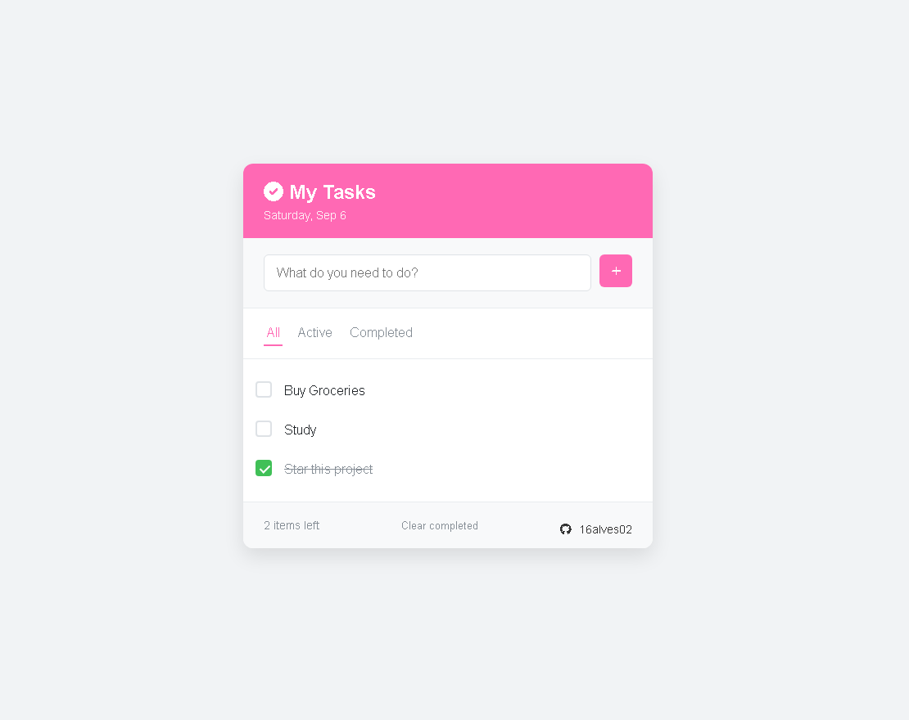

# Todo App

A small browser-based task manager built with HTML, CSS and vanilla JavaScript. The project focuses on the fundamentals of an interactive web application without relying on a frontend framework or build tools.

**[Open the live demo](https://todo-app-three-beta-56.vercel.app)**



## Features

- Add tasks using the button or Enter key.
- Mark tasks as completed or active.
- Filter the list by all, active or completed tasks.
- Delete individual tasks or clear all completed tasks.
- Save tasks in the browser with `localStorage`.
- Show the current date and the number of unfinished tasks.
- Use the interface with keyboard navigation and accessible button labels.
- Adapt the layout to smaller screens.

## Built with

| Technology | Purpose |
| --- | --- |
| HTML | Page structure and semantic elements |
| CSS | Layout, colours, responsive styling and focus states |
| JavaScript | Events, arrays, DOM updates and application state |
| `localStorage` | Saving tasks between visits in the same browser |
| Font Awesome | Interface icons |

## How it works

The application keeps its tasks in a JavaScript array. When a task changes, the app saves the array to `localStorage` and updates the visible list.

```text
User action
    |
    v
Update the task array
    |
    +----> Save to localStorage
    |
    v
Render the filtered list
```

Saved data belongs to the current browser and device. There is no server, account system or cloud synchronisation.

## Run locally

No installation is required.

```bash
git clone https://github.com/16alves02/todo-app.git
cd todo-app
```

Open `index.html` in a modern browser.

## Manual test checklist

- Add a task by clicking the plus button.
- Add a task by pressing Enter.
- Try to add a blank task or a task with spaces only.
- Mark a task as completed, then mark it active again.
- Check that All, Active and Completed show the expected tasks.
- Delete one task and clear completed tasks.
- Refresh the page and verify that saved tasks return.
- Try keyboard navigation through the input, filters and task actions.
- Check the layout at a narrow viewport.
- If possible, test with browser storage cleared or unavailable.

## What this project demonstrates

This project is an exercise in DOM manipulation, event handling, arrays, functions, filtering, conditional rendering, browser storage and basic accessibility. The JavaScript is intentionally kept in a single file so the relationship between state, events and rendering remains easy to follow.

## Known limitations

- Tasks are stored only in the current browser.
- There is no authentication, backend, multi-device sync or automated test suite.
- Task identifiers combine the current timestamp with an incrementing counter to avoid collisions when tasks are added quickly. This is sufficient for a small browser project, but it is not a general-purpose ID system.

## Author

Leonardo Alves · [@16alves02](https://github.com/16alves02) · [Portfolio](https://16alves02-com.vercel.app/)

See [LICENSE](LICENSE) for the terms under which this source code may be used.
