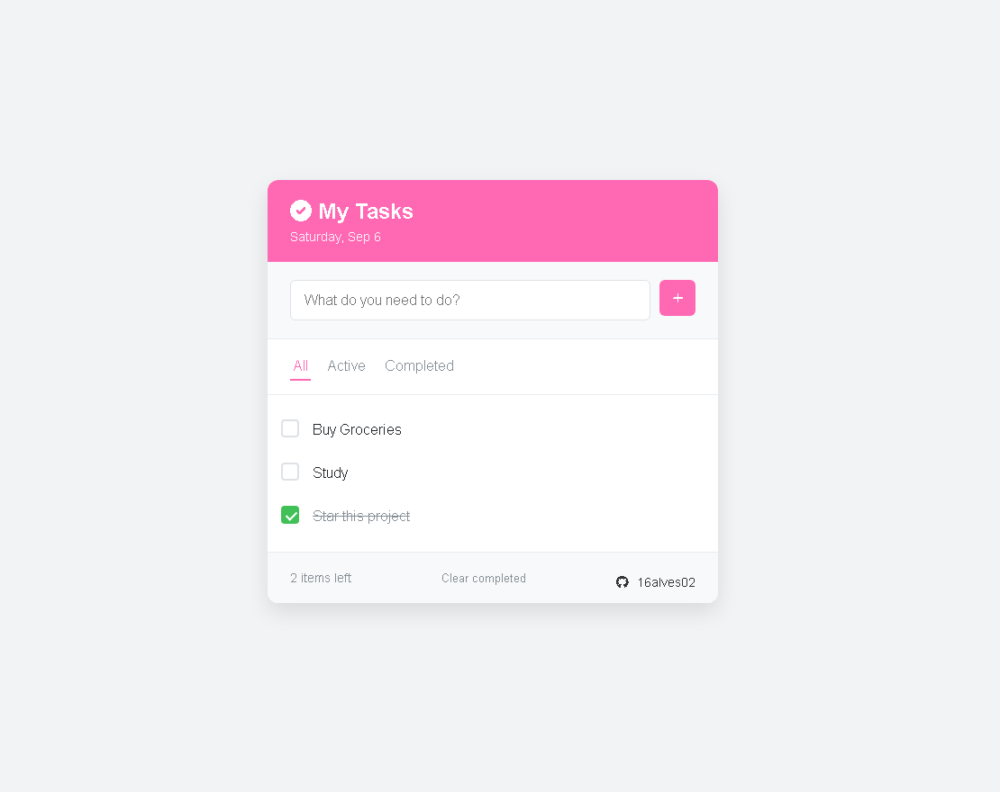

> **Idioma / Language:** [English](README.md) · [Português (Portugal)](README.pt-PT.md)

# Todo App

Gestor de tarefas no browser, desenvolvido com HTML, CSS e JavaScript vanilla. O projeto explora os fundamentos de uma aplicação web interativa sem recorrer a frameworks frontend ou ferramentas de compilação.

**[Abrir demonstração](https://todo-app-three-beta-56.vercel.app)**

## Funcionalidades

- Adicionar tarefas através do botão ou da tecla Enter.
- Marcar tarefas como concluídas ou voltar a torná-las ativas.
- Filtrar tarefas por todas, ativas ou concluídas.
- Eliminar tarefas individualmente ou limpar todas as tarefas concluídas.
- Guardar tarefas no browser através de <code>localStorage</code>.
- Mostrar a data atual e o número de tarefas pendentes.
- Suportar navegação por teclado e apresentar etiquetas acessíveis nos controlos.
- Adaptar o layout a ecrãs mais pequenos.

## Tecnologias

| Tecnologia | Finalidade |
| --- | --- |
| HTML | Estrutura da página e elementos semânticos |
| CSS | Layout, estilos, comportamento responsivo e estados de foco |
| JavaScript | Eventos, arrays, atualizações do DOM e estado da aplicação |
| <code>localStorage</code> | Guardar tarefas entre visitas no mesmo browser |
| Font Awesome | Ícones da interface |

## Funcionamento

As tarefas são guardadas num array JavaScript. Sempre que a lista é alterada, a aplicação guarda o array atualizado em <code>localStorage</code> e apresenta novamente a lista filtrada.

~~~text
Ação do utilizador
    |
    v
Atualizar o array de tarefas
    |
    +----> Guardar em localStorage
    |
    v
Apresentar a lista filtrada
~~~

As tarefas guardadas pertencem ao browser e ao dispositivo onde foram criadas. A aplicação não tem backend, contas de utilizador nem sincronização entre dispositivos.

## Executar localmente

Não é necessária instalação nem compilação.

~~~bash
git clone https://github.com/16alves02/todo-app.git
cd todo-app
~~~

Abre o ficheiro <code>index.html</code> num browser moderno.

## Verificações automatizadas

O GitHub Actions é executado em pushes e pull requests para <code>main</code>. Verifica a sintaxe JavaScript e confirma que os ficheiros JavaScript e CSS locais referenciados pelo HTML existem.

Estas verificações **não** substituem os testes funcionais num browser. Ainda não existe uma suite automatizada de testes de interação.

## Checklist de testes manuais

- Adicionar uma tarefa através do botão.
- Adicionar uma tarefa através da tecla Enter.
- Tentar adicionar uma tarefa vazia ou apenas com espaços.
- Marcar uma tarefa como concluída e voltar a marcá-la como ativa.
- Confirmar que os filtros Todas, Ativas e Concluídas apresentam as tarefas esperadas.
- Eliminar uma tarefa e limpar as tarefas concluídas.
- Atualizar a página e confirmar que as tarefas guardadas são recuperadas.
- Navegar pelo campo de introdução, filtros e ações das tarefas apenas com o teclado.
- Verificar o layout num ecrã estreito.
- Se possível, testar com o armazenamento do browser limpo ou indisponível.

## O que este projeto demonstra

Este projeto permite praticar manipulação do DOM, gestão de eventos, arrays, funções, filtragem, apresentação condicional, armazenamento do browser e acessibilidade básica. O JavaScript está concentrado num único ficheiro para tornar clara a relação entre estado, eventos e renderização.

## Limitações conhecidas

- As tarefas são guardadas apenas no browser onde foram criadas.
- Não existem autenticação, backend, sincronização entre dispositivos ou testes automatizados de interação.
- Os identificadores das tarefas combinam o timestamp atual com um contador incremental. É suficiente para um projeto pequeno, mas não é um sistema de identificadores de uso geral.

## Autor

Leonardo Alves · [@16alves02](https://github.com/16alves02) · [Portefólio](https://16alves02.pages.dev/)

Consulta [LICENSE](LICENSE) para conhecer as condições de utilização deste código-fonte.